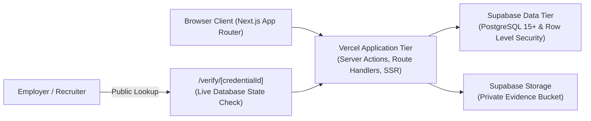

# SkillProof — Verified Skills Passport Platform

[](https://nextjs.org/)
[](https://www.typescriptlang.org/)
[](https://tailwindcss.com/)
[](https://supabase.com/)
[](LICENSE)

> **Prove Your Skills. Build Trust.**  
> A Next-Generation Verifiable Credentials & Talent Assessment Platform.

---

## 🎯 Executive Summary & Problem Statement

Employers frequently make hiring decisions based on unstandardized resumes and static certificates that fail to prove practical execution. Candidates, especially those with non-traditional backgrounds, lack a standardized way to prove their abilities before the interview stage.

**SkillProof** bridges this "proof deficit" through a 4-pillar trust protocol:
1. **Demonstrate:** Candidates select standardized, practical engineering challenges (Next.js dashboards, PostgreSQL ETL pipelines, Zero-Trust auth).
2. **Submit:** Work evidence (GitHub repositories, live deployments, architecture notes, schematics) is uploaded to private storage.
3. **Verify:** Authorized human domain experts score submissions against objective, version-controlled rubrics.
4. **Share:** Candidates receive a portable, tamper-evident **Verified Skills Passport** with a dynamic public verification endpoint (`/verify/[id]`).

---

## 🏗️ System Architecture



### Technology Stack
- **Frontend Framework:** Next.js 16 (App Router), React 19, TypeScript
- **Styling & UI:** Tailwind CSS, Radix UI primitives, Lucide icons
- **Backend & Auth:** Supabase (PostgreSQL 15+, Supabase Auth, Row Level Security)
- **Object Storage:** Supabase Storage (private `submission-evidence` bucket)
- **Validation:** Zod schemas for all client forms & server actions
- **Testing:** Node.js Native Test Runner (`node --test`)
- **Deployment:** Vercel

---

## 🔐 Security Posture & Mandatory Constraints

- **Strict Row Level Security (RLS):** All Supabase tables (`profiles`, `submissions`, `evaluations`, `credentials`, `assessments`, `assessment_rubrics`) enforce granular RLS policies. Candidates can only access their own submissions; only vetted evaluators can record rubric evaluations.
- **Server-Side Authorization:** Role checks (`candidate` vs `evaluator` vs `admin`) are verified against the database and JWT claims server-side; client role claims are never trusted.
- **Strict Data Minimization:** Public `/verify/[id]` routes expose only verified competency badges, scores, and evaluator sign-offs. Personal contact emails, phone numbers, and raw drafts remain private.
- **Audit Trails:** Evaluations are immutable audit records linking the evaluator ID, timestamp, rubric version, and score breakdown.

---

## 📊 Core Data Model

```
profiles
├── id (UUID, PK -> auth.users)
├── role ('candidate' | 'evaluator' | 'admin')
├── full_name, headline, bio
└── github_url, linkedin_url, avatar_url

assessments
├── id (UUID, PK), slug (Unique)
├── title, domain, difficulty, estimated_hours
├── summary, instructions_markdown
└── submission_requirements

assessment_rubrics
├── id (UUID, PK), assessment_id (FK), version
├── criterion_id, title, description
└── weight (%), max_points

submissions
├── id (UUID, PK), candidate_id (FK), assessment_id (FK)
├── status ('submitted' | 'under_review' | 'changes_requested' | 'approved' | 'rejected')
├── repo_url, live_url, notes_text, file_attachment_path
└── submitted_at

evaluations
├── id (UUID, PK), submission_id (FK), evaluator_id (FK)
├── decision ('approved' | 'rejected' | 'revision_requested')
├── total_score (0-100), scores_json, general_feedback
└── evaluated_at

credentials
├── id (TEXT, PK, 'skp_live_...')
├── candidate_id (FK), assessment_id (FK), evaluation_id (FK)
├── status ('valid' | 'expired' | 'revoked')
└── issued_at, expires_at
```

---

## 📅 15-Day Implementation Roadmap Status

| Day | Milestone | Status | Key Deliverable |
| :--- | :--- | :---: | :--- |
| **Day 1** | Research & Requirements | ✅ Completed | User stories, acceptance criteria, rubric scoring logic |
| **Day 2** | Architecture & Data Modeling | ✅ Completed | PostgreSQL relational schema, credential lifecycle state machine |
| **Day 3** | Environment Foundation | ✅ Completed | Next.js App Router, Tailwind CSS, Supabase SQL migrations |
| **Day 4** | Auth & Access Control | ✅ Completed | Role-based authentication, server-side JWT verification, RLS policies |
| **Day 5** | Candidate Profile | ✅ Completed | Profile editor, Zod input validation, privacy visibility controls |
| **Day 6** | Assessment Catalogue | ✅ Completed | Assessment browsing, domain filtering, dynamic detail pages |
| **Day 7** | Evidence Submission | ✅ Completed | Multi-artifact submission flow, private file storage uploads |
| **Day 8** | Evaluator Dashboard | ✅ Completed | Pending submissions queue, role-protected dashboard |
| **Day 9** | Evaluation Workspace | ✅ Completed | Weighted rubric scoring calculator, feedback & revisions |
| **Day 10** | Credential Issuance | ✅ Completed | High-entropy ID generation (`skp_live_...`), server-side validation |
| **Day 11** | Public Verification Route | ✅ Completed | Dynamic unauthenticated `/verify/[id]` endpoint with live status |
| **Day 12** | Employer Experience & Polish | ✅ Completed | Shareable view, skeleton loaders, LinkedIn share, HTML embed badge |
| **Day 13** | Security Audits & Testing | ✅ Completed | Unit test suite covering Zod schemas, boundary tests, rubric scores |
| **Day 14** | Production Deployment | ✅ Completed | `vercel.json` production headers, environment variables guide |
| **Day 15** | Validation & Handover | ✅ Completed | End-to-end verified demo accounts and handover documentation |

---

## 🧪 Demo Personas & Pre-Seeded Accounts

The application includes seeded test personas and mock fallbacks so you can test every workflow immediately:

### 1. Candidate Persona (Alex Rivera)
- **Role:** `candidate`
- **Dashboard:** `/dashboard`
- **Submissions History:** `/dashboard/submissions`
- **Verified Credentials:** `/dashboard/credentials`
- **Profile:** `/dashboard/profile`

### 2. Evaluator Persona (Dr. Marcus Chen)
- **Role:** `evaluator`
- **Queue:** `/evaluator`
- **Rubric Grading:** `/evaluator/review/sub_alex_001`
- **Capabilities:** Grade criteria 0-5, provide feedback, approve (threshold >= 75%) to generate live credential.

### 3. Employer Verification (Public)
- **Valid Credential:** [`/verify/skp_live_9f83a1b4c102`](http://localhost:3000/verify/skp_live_9f83a1b4c102)
- **Demo Credential:** [`/verify/demo`](http://localhost:3000/verify/demo)
- **Expired/Revoked States:** Demonstrates real-time verification flags.

---

## 🚀 Getting Started

### Prerequisites
- Node.js 20+ (Node 24 recommended)
- npm or pnpm
- (Optional) Supabase project for live database hosting

### 1. Clone & Install
```bash
git clone https://github.com/gkhushi512005/skillproof.git
cd skillproof
npm install
```

### 2. Configure Environment Variables
Copy `.env.example` to `.env.local`:
```bash
cp .env.example .env.local
```
Fill in your Supabase credentials (found in Supabase Dashboard -> Project Settings -> API):
```env
NEXT_PUBLIC_SUPABASE_URL=https://your-project.supabase.co
NEXT_PUBLIC_SUPABASE_ANON_KEY=your-anon-key
```

### 3. Apply PostgreSQL Migrations (Supabase)
Run the SQL scripts in order using the Supabase SQL Editor:
1. `supabase/migrations/20260101000000_init_schema.sql` (Tables, Triggers, RLS)
2. `supabase/migrations/20260102000000_storage_setup.sql` (Storage Bucket & RLS)
3. `supabase/seed.sql` (Initial assessments, rubrics, and sample accounts)

### 4. Run the Development Server
```bash
npm run dev
```
Open [http://localhost:3000](http://localhost:3000) in your browser.

### 5. Run the Test Suite
```bash
npm test
```

### 6. Build for Production
```bash
npm run build
```

---

## 🌐 Deploy to Vercel

### Option A: Deploy via Vercel Dashboard
1. Push your repository to GitHub.
2. Go to [vercel.com/new](https://vercel.com/new) and import `gkhushi512005/skillproof`.
3. In the **Environment Variables** section, add:
   - `NEXT_PUBLIC_SUPABASE_URL`
   - `NEXT_PUBLIC_SUPABASE_ANON_KEY`
   - `NEXT_PUBLIC_APP_URL` (set to your Vercel deployment URL, e.g. `https://skillproof.vercel.app`)
4. Click **Deploy**.

### Option B: Deploy via Vercel CLI
```bash
npm i -g vercel
vercel login
vercel
vercel --prod
```

---

## 📄 License
MIT License. Created for the SkillProof Verified Skills Passport platform.
